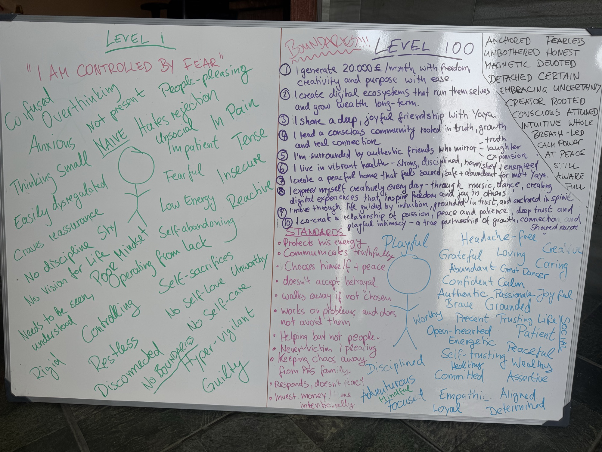

# Kevin 2.0: Vision Board

Built by Kevin in 2025 on a whiteboard. Transcribed on 2026-11-08 from the photo, which is saved here:

This is where it started. It is meant to be visible, not hidden: later it becomes part of the From The End story (Level 1 → Level 100).

**Use in content:** This is the source for Kevin's identity lines in personal tracks, in his own words. Track rules still apply: no amounts, no promises, at most three identity lines per track. The 20,000 € in statement 1 stays here and never appears in a track.

Words marked `[?]` were hard to read on the photo.

---

## Level 1: "I AM CONTROLLED BY FEAR"

Confused · Overthinking · Not present · People-pleasing · Anxious · Hates rejection · In pain · Thinking small · Naive · Unsocial · Impatient · Tense · Easily dysregulated · Fearful · Insecure · Craves reassurance · Low energy · Reactive · No discipline · Shy · Self-abandoning · No vision for life · Poor mindset · Operating from lack · Needs to be seen, understood · Controlling · Self-sacrifices · No self-love · Unworthy · No self-care · Rigid · Restless · Disconnected · No boundaries · Hyper-vigilant · Guilty

---

## BOUNDARIES!!!

## Level 100

1. I generate 20.000 €/month with freedom, creativity and purpose with ease.
2. I create digital ecosystems that run themselves and grow wealth long-term.
3. I share a deep, joyful friendship with Yaya.
4. I lead a conscious community rooted in truth, growth and real connection.
5. I'm surrounded by authentic friends who mirror truth, laughter, expansion.
6. I live in vibrant health: strong, disciplined, nourished + energized.
7. I create a peaceful home that feels sacred, safe + abundant for me + Yaya.
8. I express myself creatively every day, through music, dance, creating digital experiences that inspire freedom and joy in others.
9. I move through life guided by intuition, grounded in trust, and anchored in spirit [?].
10. I co-create a relationship of passion, peace and patience, deep trust and playful intimacy, a true partnership of growth, connection and shared purpose.

### Who I am (Level 100)

Anchored · Fearless · Unbothered · Honest · Magnetic · Devoted · Detached · Certain · Embracing uncertainty · Creator · Rooted · Conscious · Attuned · Intuitive · Whole · Breath-led · Calm power · At peace · Still · Aware · Full

Playful · Headache-free · Creative · Grateful · Loving · Caring · Abundant · Great dancer · Confident · Calm · Authentic · Passionate · Joyful · Brave · Grounded · Worthy · Present · Trusting life · Social · Open-hearted · Patient · Energetic · Peaceful · Self-trusting · Healthy · Wealthy · Committed · Assertive · Disciplined · Adventurous · Mindful · Focused · Empathic · Aligned · Loyal · Determined

### Standards

- Protects his energy
- Communicates truthfully
- Chooses himself + peace
- Doesn't accept betrayal
- Walks away if not chosen
- Works on problems and does not avoid them
- Helping but not people-pleasing
- Never victim / pleasing
- Keeping chaos away from his family
- Responds, doesn't react
- Invests money / time intentionally [?]
